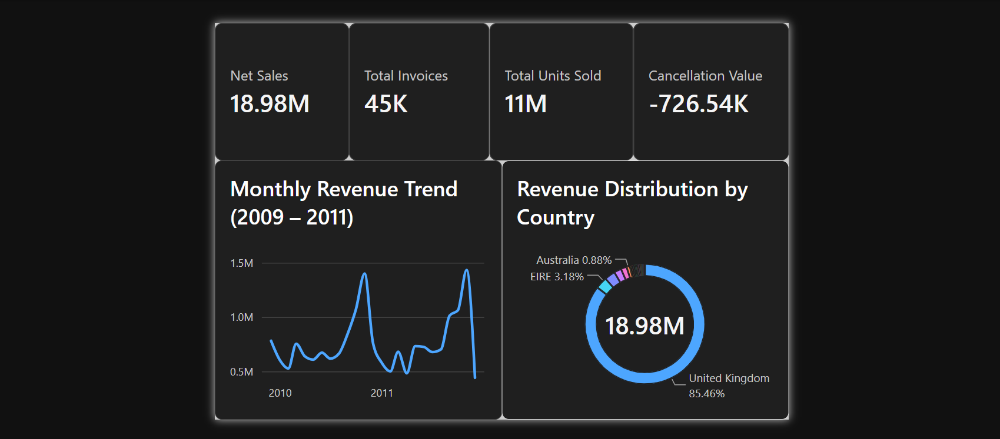
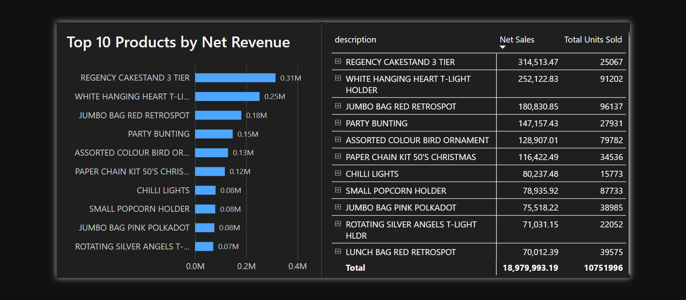
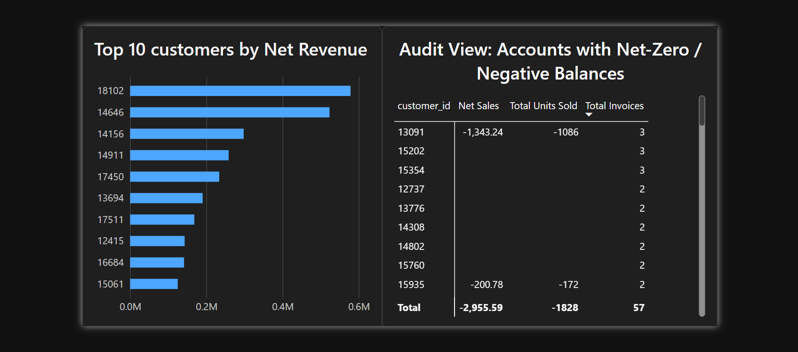

# 📊 Retail Sales Analytics & Data Pipeline Project

An end-to-end enterprise data engineering and business intelligence solution built using Python, SQLite, SQL, and Power BI. This project processes the **Online Retail II** dataset (~1.06 million raw records), cleans and flags anomalies through a automated ETL pipeline backed by unit tests, loads the normalized schema into SQLite, executes analytical SQL queries, and visualizes executive KPIs across a multi-page interactive Power BI dashboard.

---

## 🌟 Executive Summary & Key Results

* **Total Net Sales:** **£18.98M** (net of cancellations and double-entry adjustments)
* **Total Transactions:** **45,000** unique fulfilled orders
* **Total Units Sold:** **10.75M** product units
* **Cancellation Impact:** **-£726.54K** in returns and order cancellations
* **UK vs. Global Revenue:** **85.46%** (£16.22M) generated in the United Kingdom; top international markets include **EIRE (£603.4K)**, **Netherlands (£546.1K)**, and **Germany (£375.1K)**.
* **Top Product:** *Regency Cakestand 3 Tier* (£314.5K revenue, 25.1K units).

---

## 🏗️ Project Architecture

```
retail-sales-analytics/
├── data/
│   ├── raw/
│   │   └── online_retail_II.csv        # Raw dataset (~95 MB, 1,067,371 rows)
│   └── processed/
│       └── retail.db                   # Clean 3-table SQLite Database
├── docs/                               # Screenshots & documentation assets
├── sql/
│   ├── 01_monthly_sales.sql            # Monthly revenue & transaction trends
│   ├── 02_top_products.sql             # Revenue & volume rankings by product
│   ├── 03_sales_by_country.sql         # Geographic distribution & market share
│   ├── 04_sales_by_customer.sql        # Top customer accounts by net spend
│   └── 05_customers_net_zero_or_negative.sql # Audit query for returns/adjustments
├── src/
│   ├── __init__.py
│   └── pipeline.py                     # Primary ETL pipeline logic
├── tests/
│   └── test_pipeline.py                # 15 pytest unit tests on mock data
├── .gitignore
├── exploration.ipynb                   # Exploratory Data Analysis & audit trail
├── pytest.ini                          # Test configuration
├── requirements.txt                    # Python dependencies
└── README.md                           # Project Documentation
```

---

## 🧼 Data Pipeline & Cleaning Strategy

Rather than destroying raw data, this project adheres to **non-destructive data auditing principles**. Every record is preserved, categorized, and flagged to ensure full data lineage and operational transparency.

### 1. Classification Engine (`row_type`)
Using business logic rule prioritization, each row is categorized into specific transactional types:
* **`product`** (1,055,226 rows): Standard tangible sales.
* **`zero_price`** (6,202 rows): Stock write-offs, samples, or unpriced logs.
* **`shipping`** (3,913 rows): Freight, postage (`POST`, `DOT`, `C2`), and carriage charges.
* **`adjustment`** (1,495 rows): Bad debt adjustments (`B`, `ADJUST`), manual fees (`M`).
* **`discount` / `sample` / `voucher` / `test`** (374 rows combined): Auxiliary entries.

### 2. Double-Entry Window Detection (`likely_double_entry`)
Through deep exploratory analysis (`exploration.ipynb`), a systemic recording anomaly was identified between **December 1 and December 9, 2010**:
* **100% of invoices** in this 9-day window contained identical repeated rows.
* **22,523 rows** were flagged as `likely_double_entry` (representing **£377.5K** in artificially doubled revenue).
* Flagged records are excluded from core sales metrics via `is_sale = 1` filters without destroying underlying raw logs.

---

## 🗄️ Database Schema & Relational Model

The transformed data is loaded into a **3-table normalized SQLite star schema** (`retail.db`) enforced with primary keys, foreign key constraints, and transactional safety.

```
                  +-------------------+
                  |     INVOICES      |
                  +-------------------+
                  | PK  invoice_no    |
                  |     invoice_date  |
                  |     customer_id   |
                  |     country       |
                  |     is_cancellation
                  +---------+---------+
                            | 1
                            |
                            | *
                  +---------+---------+          +--------------------+
                  |   INVOICE_LINES   |          |      PRODUCTS      |
                  +-------------------+          +--------------------+
                  | PK  line_id       |        * | PK  stock_code     |
                  | FK  invoice_no    +----------+     description    |
                  | FK  stock_code    |          |     appears_in_sales
                  |     quantity      |          +--------------------+
                  |     price         |
                  |     row_type      |
                  |     is_duplicate  |
                  |     likely_double_entry
                  |     is_sale       |
                  +-------------------+
```

---

## 🧪 Automated Testing (`pytest`)

The pipeline includes **15 unit tests** (`tests/test_pipeline.py`) executing against a lightweight 15-row mocked sample dataset. These run in sub-second time without requiring access to the 95MB raw CSV file.

### Test Coverage Highlights:
* **Ingestion Guardrails:** Asserts missing files or missing required columns trigger immediate `FileNotFoundError` and `ValueError`.
* **Immutability:** Verifies functions return clean copies without mutating original source DataFrames.
* **Flag Accuracy:** Validates that duplicate flags and double-entry logic trigger **only** within the designated December 2010 window.
* **Relational Integrity:** Creates an in-memory SQLite instance, writes schema tables, verifies aggregate sums (`pytest.approx`), and confirms `PRAGMA foreign_key_check` passes with zero violations.

To run the test suite:
```bash
pytest
```

---

## 📐 Core DAX Measures

The Power BI model utilizes a dedicated `_Measures` table housing DAX logic for peak performance:

### 1. Net Sales Revenue
```dax
Net Sales = 
CALCULATE(
    SUMX('invoice_lines', 'invoice_lines'[quantity] * 'invoice_lines'[price]),
    'invoice_lines'[is_sale] = 1
)
```

### 2. Total Fulfilled Invoices
```dax
Total Invoices = 
CALCULATE(
    DISTINCTCOUNT('invoices'[invoice_no]),
    'invoices'[is_cancellation] = 0
)
```

### 3. Total Units Sold
```dax
Total Units Sold = 
CALCULATE(
    SUM('invoice_lines'[quantity]),
    'invoice_lines'[is_sale] = 1
)
```

### 4. Cancellation Value
```dax
Cancellation Value = 
CALCULATE(
    SUMX('invoice_lines', 'invoice_lines'[quantity] * 'invoice_lines'[price]),
    'invoice_lines'[row_type] = "product",
    'invoices'[is_cancellation] = 1
)
```

---

## 🖥️ Power BI Executive Dashboard

The interactive Power BI report is organized into 3 high-impact pages formatted in executive dark mode:

### Page 1: Executive Summary


* **Top KPI Bar:** Live metric tiles for Net Sales (£18.98M), Total Invoices (45K), Units Sold (11M), and Cancellation Value (-£726.54K).
* **Monthly Revenue Trend:** Interactive line chart mapping growth trajectories across 2009–2011, highlighting seasonal Q4 spikes.
* **Geographic Distribution:** Donut chart displaying market dominance (UK at 85.46% vs. key European export markets).

### Page 2: Product Performance


* **Top 10 Products Chart:** Clustered bar chart highlighting top revenue drivers.
* **Product Catalog Matrix:** Detailed searchable matrix showing `stock_code`, `description`, total net sales, and total volume sold.

### Page 3: Customer Analytics & Audit View


* **Top 10 Accounts:** Account revenue rankings (filtering out blank customer IDs).
* **Audit View Table:** Dedicated compliance view tracking accounts with net-zero or negative balances (-£2,955.59 total loss across 57 flagged invoices).

---

## 🚀 How to Reproduce

### 1. Prerequisites
* Python 3.10+ installed
* Power BI Desktop (for viewing/editing `.pbix` reports)

### 2. Environment Setup
```bash
# Clone repository
git clone https://github.com/ouiambouali/retail-sales-analytics
cd retail-sales-analytics

# Create virtual environment
python -m venv .venv
source .venv/bin/activate  # On Windows use: .venv\Scripts\activate

# Install dependencies
pip install -r requirements.txt
```

### 3. Data Download & Pipeline Execution
1. Download the **Online Retail II** dataset from Kaggle as `online_retail_II.csv`.
2. Place the raw CSV inside `data/raw/online_retail_II.csv`.
3. Run the automated ETL pipeline:
```bash
python -m src.pipeline
```
*This will generate `data/processed/retail.db` automatically.*

### 4. Running Unit Tests
```bash
pytest
```

---

## 📜 Tech Stack & Tools

* **Language:** Python 3.12 (Pandas, NumPy, Pathlib)
* **Testing:** Pytest
* **Database Engine:** SQLite 3
* **Query Language:** ANSI SQL
* **Business Intelligence:** Power BI Desktop (DAX, Power Query, Star Schema Data Modeling)
```

